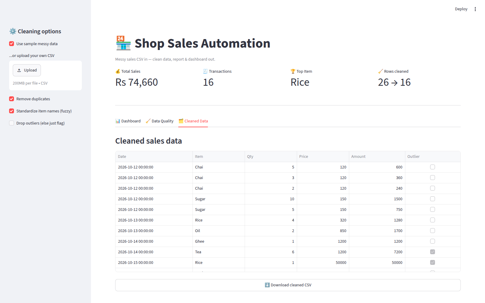
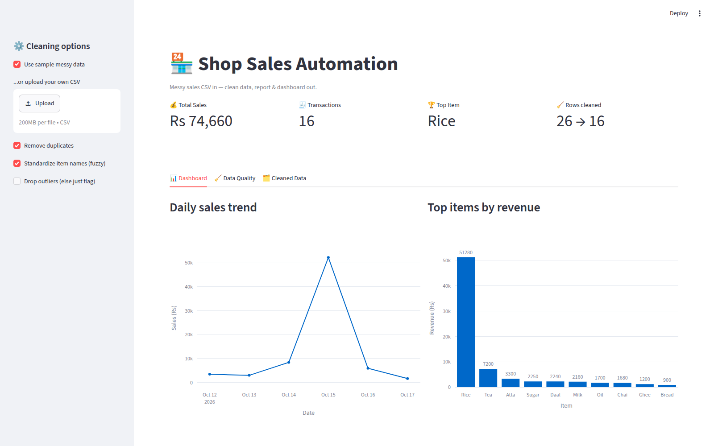
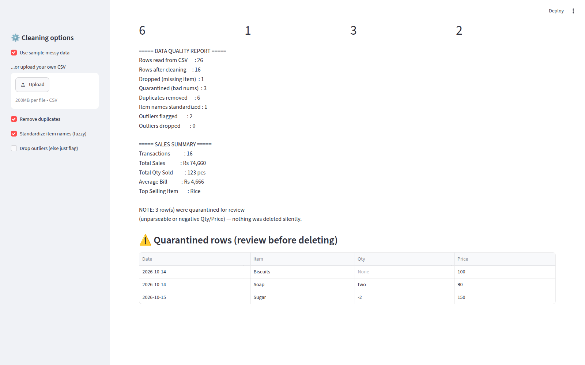

# 🏪 Shop Sales Automation

[](https://www.python.org/)
[](https://pandas.pydata.org/)
[](https://streamlit.io/)
[](https://github.com/Saghar-Siddique/Shop-Sales-Automation/actions/workflows/ci.yml)
[](https://github.com/Saghar-Siddique/Shop-Sales-Automation/actions/workflows/ci.yml)
[](LICENSE)

**Messy sales CSV in — clean data, quality report & dashboard out.**

A professional data-cleaning pipeline for small shops: it takes the kind of
messy sales records shopkeepers actually keep (missing values, " CHAI " vs
"chai", `Rs 1,200` prices, mixed date formats, duplicates, outliers) and
turns them into trustworthy data — with a full report of everything it fixed.
Nothing is deleted silently: bad rows go to quarantine for review.

**Perfect for:** retail shops, distributors, and small businesses that track
sales in Excel/CSV and need reliable numbers without manual cleanup.

## What it cleans

| Mess | Handling |
|---|---|
| Missing item names | Dropped (counted in report) |
| Unparseable / negative Qty / Price | **Quarantined** to a separate CSV for review |
| `" CHAI "` vs `"chai"` vs `"Chaai"` | Stripped + fuzzy-standardized to one name |
| `"Rs 1,200"`, `"$5"` | Currency symbols stripped → numbers |
| `12/10/2026`, `Oct 13 2026` | Mixed date formats parsed |
| Exact duplicates | Removed (counted) |
| Outliers (IQR rule) | Flagged by default, optionally dropped |

## Quickstart

```bash
pip install -r requirements.txt

# CLI: clean the sample messy file
python -m sales_automation.cli data/sales_messy.csv -o out/

# Interactive dashboard
streamlit run dashboard_app.py
```

CLI options: `--no-dedupe`, `--no-standardize`, `--drop-outliers`,
`--keep-missing`, `-o/--output-dir`.

## Interactive dashboard

- 📤 Upload your own CSV **or** use the built-in messy sample
- ⚙️ Toggle every cleaning rule live in the sidebar and watch results change
- 📊 KPIs, daily trend & top-items charts (Plotly)
- 🧹 Data-quality tab: exactly what was fixed, dropped or quarantined
- ⬇️ One-click download of the cleaned CSV

## Screenshots





## Project structure

```
sales_automation/
  cleaner.py     # pandas cleaning pipeline (CleanConfig / CleanResult)
  analyzer.py    # KPIs, daily trend, top items
  reporter.py    # plain-text quality report
  cli.py         # argparse entry point
dashboard_app.py # Streamlit dashboard
tests/           # pytest suite (cleaner, analyzer, CLI)
evals/           # cleaner accuracy eval (82 tough cases)
data/
  sales_messy.csv  # 26-row sample with 8 kinds of mess
requirements.txt
```

## Sample data

`data/sales_messy.csv` (26 rows) contains: missing values, case/space
variants, a fuzzy typo (`Chaai`), currency-formatted prices, mixed date
formats, 5 duplicate pairs, bad/negative numbers and a price outlier —
so every feature is demonstrable in one run.

## Tests

```bash
pytest -q
```

CI runs the suite on every push and PR.

## Evals

`tough, adversarial` cleaner eval — 82 cases with ground truth
(`evals/cleaner_cases.csv`): fuzzy-merge traps, false-merge traps
(similar names that are *different* products), quarantine edge cases,
currency quirks, fractional quantities, garbage dates and duplicates.

```bash
python evals/run_cleaner_eval.py
# Overall: 78/82 = 95% (measured Oct 2026)
```

Per-bucket: standardize 28/32 · no-false-merge 25/25 · quarantine 8/8 ·
numbers 6/6 · missing-item 3/3 · dates 4/4 · duplicates 4/4.
The eval caught and fixed two real issues: a fuzzy chain-merge
overwrite bug and `'Rs. 1,200'` (period) prices being quarantined.

**Threshold choice (precision-first):** the 0.85 fuzzy cutoff is
deliberate, not arbitrary. Adversarial distinct-product pairs
(`Cake`/`Cupcake` 0.73, `Coffee`/`Cold Coffee` 0.71, `Doodh`/`Doodhpatti`
0.67) sit just below real typo variants (`suger` 0.80, `Atta` 0.75) —
no single threshold separates them with margin. For a money tool a
*missed* merge (visible as two lines) is safer than a *wrong* merge
(silently mixed sales totals), so the cutoff favors precision.
